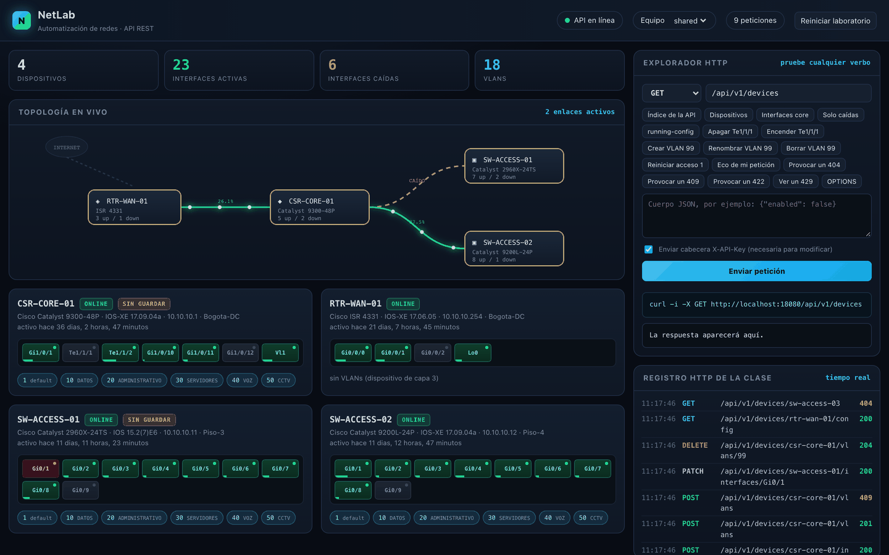

# NetLab · laboratorio de automatización de redes por API

Un ingeniero de redes que no domina HTTP no puede automatizar nada: no entiende
por qué falla un script de Ansible, no sabe leer un `401` ni distinguirlo de un
`403`, y no puede consumir la API de un controlador real. NetLab ataca ese
vacío: simula cuatro dispositivos Cisco y los expone por una API REST completa,
con una interfaz visual animada, para que los estudiantes apaguen puertos,
creen VLANs y reinicien equipos usando únicamente `curl` y Python, viendo el
efecto de cada comando proyectado en tiempo real.

**Audiencia:** docentes y estudiantes de redes (nivel CCNA o similar) con manejo
básico de terminal. No se requiere experiencia en programación.

NetLab es un proyecto de código abierto de
[CTH Soluciones Tecnológicas](https://cthsoluciones.com).



Todo el laboratorio es **un solo archivo de Python sin dependencias**: no hay
`pip install` ni framework, y el estado se guarda en SQLite, que viene en la
librería estándar. Corre en cualquier computador con Python 3.8 o superior, en
Windows, macOS o Linux.

## Cómo correrlo

### Opción 1: solo Python (lo más simple)

Windows (CMD o PowerShell):

```bat
python app\netlab.py
```

Linux / macOS:

```bash
python3 app/netlab.py
```

Al arrancar imprime la URL lista para abrir: la interfaz visual queda en
<http://localhost:8080/> y la API en `http://localhost:8080/api/v1`. Para usar
otro puerto, defina la variable de entorno `PORT` antes de arrancar.

El estado se guarda en un archivo `netlab.db` (SQLite) en el directorio actual,
así que cerrar y volver a abrir el laboratorio no pierde el trabajo. Para una
sesión efímera arranque con `NETLAB_DB=off`.

### Opción 2: Docker

La imagen pública (amd64 y arm64) está en GitHub Container Registry; no hay que
clonar nada:

```bash
docker run -p 8080:8080 -v netlab-datos:/data ghcr.io/cth-soluciones/netlab
```

El volumen `netlab-datos` guarda el estado (SQLite): recrear el contenedor no
pierde el trabajo de la clase. Para empezar de cero, borre el volumen
(`docker volume rm netlab-datos`) o use el botón de reinicio de la interfaz.

**Fije la versión para la clase.** Sin etiqueta, Docker usa `latest`, que sigue
la rama `main` y cambia con cada publicación. Para que el laboratorio no cambie
a mitad de curso, indique la versión:

```bash
docker run -p 8080:8080 -v netlab-datos:/data ghcr.io/cth-soluciones/netlab:1.0.0
```

La etiqueta `1.0` avanza con las correcciones de la serie 1.0.x; `1.0.0` no se
mueve.

Si ya clonó el repositorio, `docker compose up` hace lo mismo construyendo la
imagen localmente. Vea [Construir la imagen](#construir-la-imagen) para los
detalles del build.

> La API escucha en IPv4 e IPv6 (pila dual), así que `localhost` funciona
> también en los entornos Docker que reenvían los puertos por IPv6, como
> OrbStack. Si ve "connection reset" en el navegador, está corriendo una
> imagen antigua: haga `docker pull ghcr.io/cth-soluciones/netlab`.

### Opción 3: expuesto a internet (para academias)

Si quiere que todo el curso trabaje contra una sola instancia publicada en una
URL, tiene dos caminos:

- **Un servidor con Docker:** ejecute `docker compose up -d` en cualquier VPS
  y ponga delante su proxy inverso habitual (Caddy, nginx, Traefik) con TLS.
  No hay más piezas: la aplicación es un único contenedor con un volumen para el estado.
- **Kubernetes:** los manifiestos están en `k8s/` y el script
  `k8s/desplegar.sh` los aplica con su dominio:

  ```bash
  NETLAB_DOMINIO=netlab.mi-academia.edu ./k8s/desplegar.sh
  ```

**Antes de exponerlo, cambie las claves.** Las claves de fábrica
(`netlab-admin-2026` y `netlab-lectura-2026`) son públicas porque están en la
guía. Defina las suyas con variables de entorno:

```bash
NETLAB_ADMIN_KEY=mi-clave-secreta NETLAB_READONLY_KEY=mi-clave-lectura python3 app/netlab.py
```

Con Docker Compose, descomente el bloque `environment` de `docker-compose.yml`.
En Kubernetes no hace falta: la primera vez, `k8s/desplegar.sh` crea el secreto
`netlab-claves` con claves aleatorias (`openssl rand -hex 16`) y las imprime una
sola vez, así que anótelas al desplegar.

**Qué hace la interfaz con la clave de administrador:**

- Si la clave es **la de fábrica** (el uso normal en un aula local), el servidor
  la entrega a la interfaz y todo funciona sin pedir nada. No filtra nada que no
  sea ya público.
- Si usted definió **una clave propia**, el servidor no la incluye en la página.
  La interfaz la pide la primera vez que hace falta (enviar con clave o
  reiniciar) y la guarda en el `sessionStorage` del navegador, o sea hasta que se
  cierre la pestaña. En el `curl` de ejemplo de la interfaz aparece `$K` en vez
  de la clave.
- Al arrancar, NetLab imprime un aviso si alguna de las dos claves es la de
  fábrica. Quien lo expone a internet con la clave de fábrica sigue expuesto: el
  aviso lo dice, pero no lo impide.

Tenga en cuenta que es un laboratorio didáctico, no un servicio productivo: la
memoria es la fuente de verdad y SQLite solo guarda una copia del estado, las
lecturas GET son abiertas a propósito y no hay registro de auditoría.

## Contenido del repositorio

| Ruta | Qué es |
|---|---|
| `guia/GUIA-LAB-CURL.md` | Guía del laboratorio: anatomía de un comando `curl`, 11 bloques de ejercicios con comandos para Windows (CMD) y Linux/macOS, retos y tablas de referencia |
| `cliente/netlab_cli.py` | Cliente interactivo en Python; 15 opciones de menú y un recorrido automático para proyectar |
| `app/netlab.py` | La API y el simulador de dispositivos (un solo archivo, librería estándar) |
| `app/ui.html` | La interfaz visual: topología, panel de puertos, registro HTTP en vivo |
| `docs/` | Material de clase publicado en GitHub Pages (ver abajo) |
| `Dockerfile`, `docker-compose.yml` | Ejecución en contenedor |
| `.github/workflows/publicar-imagen.yml` | Publicación automática de la imagen en ghcr.io |
| `k8s/` | Manifiestos y script para publicarlo en un cluster (opcional) |
| `tests/` | Pruebas con `unittest` de la librería estándar: `python3 -m unittest discover -s tests`. Las de la interfaz usan Playwright y se omiten si no está instalado |

### Material de clase en línea

Además de la guía, el material de apoyo está publicado en
<https://cth-soluciones.github.io/netlab/>:

- **[Anatomía de una petición HTTP](https://cth-soluciones.github.io/netlab/anatomia-api-http.html)** —
  página interactiva sobre métodos, cabeceras y códigos de estado.
- **[Comparativo JSON · XML · YAML](https://cth-soluciones.github.io/netlab/formatos-datos-automatizacion-redes.pdf)** —
  diapositivas de la sesión de formatos de datos (también en
  [PPTX](docs/formatos-datos-automatizacion-redes.pptx) editable).

## Cómo dar la clase

1. Arranque el laboratorio y proyecte <http://localhost:8080/> (o la URL
   pública si lo desplegó en internet). Cada comando de los estudiantes aparece
   en **Registro HTTP de la clase** y su efecto se ve en la topología.
2. Abra el recorrido guiado para la introducción:
   ```bash
   python3 cliente/netlab_cli.py --demo
   ```
   Doce pasos con pausa entre cada uno, desde el inventario hasta la auditoría.
3. Reparta `guia/GUIA-LAB-CURL.md`. Los bloques 0 a 9 toman unos 90 minutos.
4. Si el laboratorio queda desordenado, reinícielo desde el botón de la
   interfaz o con:
   ```bash
   curl -X POST -H "X-API-Key: netlab-admin-2026" http://localhost:8080/api/v1/reset
   ```
   (con la clave de fábrica; si definió otra, use la suya).

### Trabajo por equipos

Con 30 estudiantes sobre la misma red los cambios se pisan. La cabecera
`X-Lab-Team` da a cada equipo una copia privada y completa de los cuatro
dispositivos:

```bash
curl -H "X-Lab-Team: rojo" http://localhost:8080/api/v1/devices
python3 cliente/netlab_cli.py --equipo rojo
```

Hay un **tope de 50 equipos** por proceso, y `shared` cuenta. Un curso de 30
estudiantes en equipos cabe de sobra; cada equipo es un mundo completo en memoria
y el tope evita que cualquiera con acceso a la URL llene el servidor inventando
nombres. Un equipo nuevo por encima del tope recibe **`403`** con el código
`limite_de_equipos`, y el mensaje de la respuesta dice cómo liberar uno. Con más
de 50 equipos hay que reiniciar el laboratorio o usar dos instancias.

En la interfaz visual, el selector **Equipo** de la cabecera cambia lo que se
muestra; también acepta `?team=rojo` en la URL. El desorden compartido resulta
didáctico al principio, así que conviene empezar en `shared` y separar por
equipos cuando lleguen a los retos finales.

## Qué enseña la API

Cubre deliberadamente todo el temario de HTTP con casos reales de red:

- **Verbos:** `GET`, `POST`, `PUT`, `PATCH`, `DELETE`, `HEAD`, `OPTIONS`.
- **Códigos:** `200`, `201`, `202`, `204`, `302`, `304`, `400`, `401`, `403`,
  `404`, `405`, `409`, `412`, `415`, `422`, `429`.
- **Cabeceras:** `X-API-Key`, `Content-Type`, `Accept`, `Location`, `ETag`,
  `If-Match`, `If-None-Match`, `Allow`, `Retry-After`, `WWW-Authenticate`.
- **Conceptos:** idempotencia, negociación de contenido, caché condicional,
  concurrencia optimista, límite de peticiones, CORS y preflight.

Los enlaces entre dispositivos están simulados de verdad: apagar `Te1/1/1` en el
core tumba `Gi0/1` en `sw-access-01`, lo que hace visible el impacto de un cambio.
Hay endpoints didácticos bajo `/api/v1/demo/` (`echo`, `status/{código}`,
`slow`, `rate-limit`, `redirect`) para provocar cualquier comportamiento a
voluntad.

**Por qué los mensajes de la API no llevan tildes.** La guía y la interfaz sí las
llevan, pero las respuestas de la API (`mensaje`, `detalle`) están en español sin
tildes, a propósito: la API responde en UTF-8, y el CMD de Windows con su página
de códigos por defecto muestra rotas las tildes que curl imprime. Como la guía
usa CMD para Windows, un mensaje ilegible en medio de una clase cuesta más que una
tilde. Los ejemplos de respuesta de la guía se copian tal como responde la API.

## Arquitectura y decisiones

- **Solo librería estándar de Python.** Sin `pip install` ni imágenes propias
  que construir, el laboratorio es inmune a fallos de red o de registro de
  contenedores el día de la clase, al precio de renunciar a un framework y su
  documentación automática. Para un aula, esa robustez vale más.
- **Estado en memoria con instantáneas en SQLite.** La memoria sigue siendo la
  fuente de verdad (rápida y simple); cada 5 segundos el estado de cada equipo
  se guarda en una base SQLite (`sqlite3` viene en la librería estándar, así
  que sigue sin haber dependencias) y se restaura al arrancar. Un reinicio del
  contenedor ya no borra el trabajo de la clase; para volver al estado inicial
  están el botón de la interfaz y `POST /api/v1/reset`. Si prefiere el
  laboratorio efímero de antes, arranque con `NETLAB_DB=off`; la ruta del
  archivo se cambia con esa misma variable.
- **Una sola réplica.** Con dos réplicas cada petición caería en un mundo
  distinto y la clase vería datos incoherentes; SQLite aquí es una copia de
  respaldo del estado, no una base compartida entre procesos.
- **Sondeo silencioso.** La interfaz refresca con
  `GET /api/v1/topology?silent=1` cada 1,5 segundos. El parámetro `silent`
  evita que ese sondeo, y las sondas de salud de Docker o Kubernetes, ensucien
  el registro que se proyecta a los estudiantes.

## Construir la imagen

No necesita construirla para usar el laboratorio: `ghcr.io/cth-soluciones/netlab`
ya está publicada. Esta sección es para quien quiera modificar el código y
producir su propia imagen.

**Build local** (la arquitectura de su máquina):

```bash
docker build -t netlab .
docker run -p 8080:8080 netlab
```

El `Dockerfile` copia solo `app/netlab.py` y `app/ui.html` sobre
`python:3.12-slim` y corre como usuario sin privilegios; no hay `pip install`
porque la API usa únicamente la librería estándar. Por eso el build tarda
segundos y la imagen queda en unos 200 MB, casi todo de la imagen base.

**Build multiarquitectura** (amd64 + arm64), para publicar en su propio
registro:

```bash
docker buildx build --platform linux/amd64,linux/arm64 \
  -t su-registro.ejemplo.com/netlab:latest --push .
```

**Publicación automática:** el workflow
[`.github/workflows/publicar-imagen.yml`](.github/workflows/publicar-imagen.yml)
reconstruye y publica `ghcr.io/cth-soluciones/netlab` (etiquetas `latest` y
`sha-<commit>`) cada vez que cambia algo en `app/` o en el `Dockerfile` en la
rama `main`. Al empujar una etiqueta `v*` (por ejemplo `v1.0.0`) publica además
las etiquetas de versión `1.0.0` y `1.0`. Antes de publicar corre las pruebas y,
si fallan, no publica nada. Si hace un fork, solo debe cambiar el nombre de la imagen en ese
archivo: el `GITHUB_TOKEN` del propio workflow tiene permiso de publicar en el
ghcr.io de su cuenta.

## Operación en Kubernetes (solo si usó la opción 3)

```bash
kubectl logs -n netlab -l app=netlab-api -f              # ver registros
kubectl rollout restart deploy/netlab-api -n netlab      # reiniciar y limpiar estado
kubectl delete namespace netlab                          # borrar todo al terminar
```

Para editar el código y volver a publicarlo basta modificar `app/netlab.py` o
`app/ui.html` y ejecutar de nuevo `desplegar.sh`: el script regenera el
ConfigMap y reinicia el pod por cambio de hash. Al terminar el curso, borre
también el registro DNS que haya creado.

## Licencia

[MIT](LICENSE). Úselo, modifíquelo y adáptelo a su curso libremente.

## Marcas

Cisco, Catalyst, ISR e IOS XE son marcas de Cisco Systems, Inc. NetLab no está
afiliado a Cisco ni respaldado por ella.
